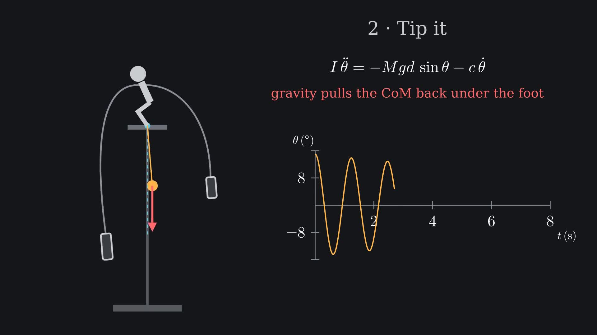

# The Balancing Sculpture

[](https://github.com/exosphere8/balancing-sculpture/actions/workflows/ci.yml)
[](LICENSE)


**Why a steel figure balanced on one toe never falls — explained with a physics model, a Manim animation and an interactive web app.**



A viral sculpture shows a figure standing on one foot on a tiny plate, arms swept back to two hanging weights. It wobbles but never falls, and it looks like it defies physics. It doesn't. The heavy weights on long curved arms pull the combined centre of mass **below** the foot, so the whole thing is a pendulum hanging from that single contact point. Upright is the position of lowest potential energy, and any tilt is pulled back.

## Contents

- [Features](#features)
- [Quick start](#quick-start)
- [The physics in one table](#the-physics-in-one-table)
- [Project structure](#project-structure)
- [Customising the model](#customising-the-model)
- [Testing](#testing)
- [Deploying the web app](#deploying-the-web-app)
- [License](#license)

## Features

- **Physics model** (`physics.py`): centre of mass, torque balance, moment of inertia, small-angle period, equivalent pendulum length, and a full nonlinear ODE simulation with damping.
- **Manim animation** (`scene.py`): a ~80-second explainer — finding the centre of mass, the torque balance, a live tip-and-sway with a θ(t) graph, the period derivation, and what happens without the weights.
- **Interactive web app** (`web/`): drag the sculpture to tip it, change every mass and arm, switch presets, and watch the centre of mass, period, θ(t) and the energy well update live. Includes the full derivation and a calculator that turns a stopwatch reading from the real video into the hidden centre-of-mass depth.
- **One-command build** (`render.py`): renders the video and exports the simulation data the page uses, so the animation and the web app always come from the same numbers.
- **Tests and CI**: pytest checks the model against the hand derivation, energy conservation, and the measured simulation period.

## Quick start

### Just the web app

The rendered video is already committed, so nothing needs building:

```bash
git clone https://github.com/exosphere8/balancing-sculpture.git
cd balancing-sculpture
python -m http.server -d web 8000
# open http://localhost:8000
```

### Re-render the animation

Manim needs a few system packages: **ffmpeg**, a **LaTeX** distribution with `dvisvgm`, and **Pango/Cairo** development libraries. See the [Manim installation guide](https://docs.manim.community/en/stable/installation.html) for your OS. Then:

```bash
python -m venv venv
source venv/bin/activate            # Windows: venv\Scripts\activate
pip install -r requirements.txt

python render.py                    # 1080p30 video + data export -> web/assets/
python render.py --quick            # fast 480p preview
python render.py --data-only        # only re-export web/assets/data.json
```

Or render the scene directly with Manim:

```bash
manim -pqh scene.py BalancingSculpture
```

### Just the numbers

```bash
pip install numpy scipy
python physics.py
```

## The physics in one table

Estimated from the video: figure 160 g, weights 240 g and 200 g. Pivot at the origin, *y* up.

| Quantity | Formula | Value |
|---|---|---|
| Tipping moment | Σ m x | 0 (balanced) |
| Centre-of-mass depth below foot | d = −Σ m y / M | 14.4 cm |
| Moment of inertia | I = Σ m (x² + y²) | 0.0323 kg·m² |
| Restoring stiffness | M g d | 0.848 N·m |
| Equation of motion | I θ″ = −M g d sin θ − c θ′ | physical pendulum |
| Small-angle period | T = 2π √(I / M g d) | 1.23 s |
| Equivalent simple pendulum | I / (M d) | 37 cm |
| Without the weights | θ = θ₀ cosh(λt), λ = √(g/h) | 1° → 30° in 0.37 s |

The full step-by-step derivation is in **[docs/PHYSICS.md](docs/PHYSICS.md)**.

## Project structure

```
balancing-sculpture/
├── physics.py              # physics model + ODE simulation
├── scene.py                # Manim scenes
├── render.py               # build: data export + video render
├── tests/
│   └── test_physics.py     # model checks (pytest)
├── docs/
│   └── PHYSICS.md          # full derivation
├── web/                    # static web app (see web/README.md)
│   ├── index.html
│   ├── style.css
│   ├── app.js
│   └── assets/             # rendered video, poster, data.json
├── .github/workflows/
│   ├── ci.yml              # tests on every push / PR
│   └── pages.yml           # deploys web/ to GitHub Pages
├── pyproject.toml
├── requirements.txt
├── requirements-dev.txt
├── CONTRIBUTING.md
└── LICENSE
```

## Customising the model

Every part is a `PointMass(name, m, x, y)` in kilograms and metres. Build your own sculpture and inspect it:

```python
from physics import Sculpture, PointMass

s = Sculpture(parts=[
    PointMass("figure", 0.20, 0.0, 0.10),
    PointMass("left",   0.30, -0.15, -0.30),
    PointMass("right",  0.30,  0.15, -0.30),
], damping=0.002)

print(s.stable, s.d, s.period)
t, theta, omega = s.simulate(theta0_deg=20, t_max=10)
```

To animate your own configuration, change the default `parts` in `Sculpture` and run `python render.py`. In the browser, the sliders do the same thing live.

## Testing

```bash
pip install -r requirements-dev.txt
pytest
```

The suite checks the centre of mass, torque balance, moment of inertia and period against the hand-derived values, verifies energy is conserved with zero damping, measures the simulated period from zero crossings, and confirms the bare figure topples in about 0.37 s.

## Deploying the web app

`.github/workflows/pages.yml` publishes the `web/` folder to GitHub Pages on every push that touches it. To turn it on, open the repo's **Settings → Pages** and set **Source** to **GitHub Actions**. The site will then be live at `https://exosphere8.github.io/balancing-sculpture/`.

## License

[MIT](LICENSE) © 2026 exosphere8.

The sculpture that inspired this project is the work of its original artist; this repo only models the physics and contains no images of the original piece.
